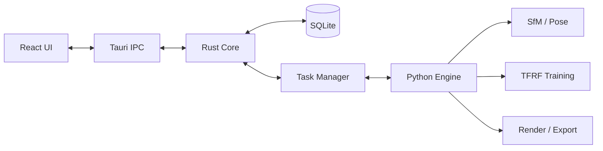

# Titan 技术选型与开发流程

> 本文档定义 Titan 第一阶段需求范围、技术选型、系统架构、模块划分、开发里程碑、测试与风险计划。
> 品牌与 UI 规范见 `design/`，算法设计见 `docs/算法方案.md`。

## 1. 产品定位

Titan 面向摄影师、设计团队、数字孪生与内容创作者，提供本地优先的图片三维重建工作流：上传一组多视角图片，经稀疏重建、位姿估计与神经辐射场训练，输出可交互查看的三维场景与渲染图像。

核心体验：

- 拖拽上传图片，自动执行特征提取、位姿估计与重建训练。
- 工作台三段式：项目列表、场景画布、参数与指标面板。
- 训练过程可暂停、恢复、中断；指标实时更新。
- 结果支持渲染图像导出与场景交互查看。

## 2. Logo 与主题摘要

- Logo 方案：Facet T（棱面 T），由三块棱面组成立体 T，上方为开口扫描轨道弧与相机点。
- 主题色：霜青 Titan Frost，主色 `#0FA896`，亮青 `#2ED3BE`，深青 `#0B7A70`。
- 深色模式窗口底 `#101820`，卡片底 `#18232D`；浅色模式窗口底 `#F2F4F1`，卡片底 `#FBFCFA`。
- 完整规范见 `design/logo-design.md` 与 `design/ui-design-system.md`。

## 3. 技术选型

### 3.1 目标硬件与显存预算（8GB VRAM）

目标设备为 8GB 显存 GPU（如 RTX 3060/4060、GTX 1080 级别），所有训练与实时预览配置都以这一预算为约束：

| 配置项 | 默认值 | 说明 |
| --- | --- | --- |
| 训练分辨率 | 1280x720 | 可按显存降级到 960x540 |
| 混合精度 | FP16 | 默认开启，显存不足时自动降级分辨率而不是崩溃 |
| 训练采样 | patch 4096 像素/步 | 不做整图前向，避免峰值显存爆炸 |
| 训练显存占用 | <= 6.5GB | 为 UI 与系统预留至少 1.5GB |
| 实时预览 | 20-40 FPS @ 1280x720 | 训练结束后进入交互查看模式 |

工程约束：训练器启动前做显存探针，按可用显存动态选择分辨率、patch 大小与棱面上限；显存不足时给出明确建议而不是静默失败。

### 3.2 桌面框架

- 桌面壳：Tauri 2 + Rust，Windows 使用 WebView2；安装包小、内存占用低，适合本地重计算应用。
- 前端：React 19 + TypeScript + Vite，路由使用 `react-router-dom`，图标使用 `lucide-react`。
- 3D 视图：Three.js（M3 引入），用于点云、网格、相机路径与场景画布。
- 数据持久化：SQLite（M2 引入），由 Rust 封装为 Tauri command。
- 本地文件交互：`@tauri-apps/plugin-dialog`、`@tauri-apps/plugin-fs`（按里程碑逐步加权限）。
- 桌面进程：Rust 负责数据库、任务调度与子进程管理；算法重活放 Python sidecar。

### 3.3 算法运行时

- Python 3.11 + PyTorch + CUDA，独立 venv 随应用分发或首次运行时引导安装。
- SfM：优先调用 COLMAP 作为外部引擎；无 COLMAP 时提供降级路径（OpenCV 基础位姿或用户导入位姿）。
- 算法引擎与 UI 通过 Rust 子进程 + JSON/文件协议通信，进度与指标以 Tauri event 回传。

## 4. 系统架构



分层原则：UI 不直接访问文件系统与子进程；所有数据读写经过 Rust command；Python 引擎以任务为单位启动，支持暂停、恢复、取消与指标回传。

## 5. 模块划分

| 模块 | 职责 | 里程碑 |
| --- | --- | --- |
| Frontend Shell | 侧边栏、顶栏、主题、路由、布局 | M1 |
| Project Manager | 项目创建、列表、SQLite 持久化 | M2 |
| Image Import | 拖拽/对话框导入、缩略图、校验 | M2 |
| Scene View | Three.js 画布、相机轨迹、点云/网格加载 | M3 |
| Task Center | 训练任务调度、暂停/恢复/取消、状态事件 | M4 |
| Metrics Panel | PSNR/SSIM/LPIPS、显存、剩余时间 | M4 |
| Python Engine | SfM、数据准备、TFRF 训练、渲染导出 | M4 |
| Settings | 主题、GPU 预算、Python 环境、日志 | M1/M5 |

## 6. 数据模型（SQLite）

```sql
CREATE TABLE projects (
  id TEXT PRIMARY KEY,
  name TEXT NOT NULL,
  status TEXT NOT NULL DEFAULT 'idle',
  settings_json TEXT NOT NULL DEFAULT '{}',
  created_at INTEGER NOT NULL,
  updated_at INTEGER NOT NULL
);

CREATE TABLE images (
  id TEXT PRIMARY KEY,
  project_id TEXT NOT NULL REFERENCES projects(id) ON DELETE CASCADE,
  path TEXT NOT NULL,
  width INTEGER,
  height INTEGER,
  size INTEGER,
  status TEXT NOT NULL DEFAULT 'pending',
  thumbnail_path TEXT,
  sort_order INTEGER NOT NULL DEFAULT 0
);

CREATE TABLE tasks (
  id TEXT PRIMARY KEY,
  project_id TEXT NOT NULL REFERENCES projects(id) ON DELETE CASCADE,
  type TEXT NOT NULL,
  status TEXT NOT NULL,
  progress REAL NOT NULL DEFAULT 0,
  started_at INTEGER,
  finished_at INTEGER,
  error TEXT
);

CREATE TABLE metrics (
  id TEXT PRIMARY KEY,
  task_id TEXT NOT NULL REFERENCES tasks(id) ON DELETE CASCADE,
  step INTEGER NOT NULL,
  psnr REAL,
  ssim REAL,
  lpips REAL,
  loss REAL,
  vram_mb INTEGER,
  created_at INTEGER NOT NULL
);
```

## 7. Tauri 命令设计

| 命令 | 输入 | 返回 | 里程碑 |
| --- | --- | --- | --- |
| `create_project` | name, settings | project | M2 |
| `list_projects` | - | project[] | M2 |
| `import_images` | projectId, paths | image[] | M2 |
| `start_reconstruction` | projectId, config | taskId | M4 |
| `pause_task` / `resume_task` / `cancel_task` | taskId | status | M4 |
| `get_metrics` | taskId, afterStep | metrics[] | M4 |
| `export_render` | projectId, format, path | result | M4 |
| `app_info` | - | name, version, engine, gpuBudget | M1 |

所有命令必须注册进 `generate_handler!`，并按最小权限加入 capability。

## 8. 开发里程碑

| 阶段 | 内容 | 验收 |
| --- | --- | --- |
| M0 品牌与设计 | Logo、主题令牌、设计规范、预览页 | 文档与预览可评审 |
| M1 桌面骨架 | Tauri + React 初始化、侧边栏/顶栏/主题切换、路由 | 深浅主题可切换，UI 与规范一致 |
| M2 上传与项目 | 项目创建、图片拖拽导入、缩略图列表、SQLite 持久化 | 100 张图导入不卡顿，重启后项目可见 |
| M3 场景预览 | Three.js 画布、相机轨迹、点云/网格加载、基础交互 | 支持旋转/缩放/选点 |
| M4 算法引擎 | SfM 适配、Facet Radiance Field 训练、指标回传、渲染导出 | 8GB 显存 GPU 上小规模场景端到端重建成功 |
| M5 工程化 | 自动更新、崩溃上报、日志、性能优化、打包签名 | 可分发安装包 |

## 9. 测试计划

- 单元测试：Rust 命令、数据模型、图像校验；Python 损失函数、采样、渲染前向/反向。
- 组件测试：React Testing Library 覆盖上传流程、任务状态、主题切换。
- 集成测试：Tauri + Python 子进程端到端小数据集（如 20-50 张图）。
- 视觉回归：Playwright 截图对比设计规范，检查深浅主题、固定尺寸组件与文字溢出。
- 算法评估：公开数据集（Blender 合成场景、Mip-NeRF 360 子集、Tanks&Temples 子集）跑 PSNR/SSIM/LPIPS。
- 性能测试：在 8GB 显存 GPU 上验证默认配置训练显存不超 6.5GB，CPU 训练小场景、1000 张图片导入耗时。

## 10. 风险计划

| 风险 | 影响 | 缓解 |
| --- | --- | --- |
| 8GB 显存不足 | 训练失败或过慢 | 显存探针、分辨率/采样自动降级、patch 采样、分块训练 |
| COLMAP 安装与兼容 | SfM 不可用 | 外部命令检测 + 内置降级 SfM/位姿导入 |
| Python 环境复杂 | 首次启动失败 | 引导安装/校验、失败日志与诊断页 |
| WebView2 缺失 | 窗口白屏 | 安装包前置检测与引导 |
| 训练时间过长 | 用户等待 | 可中断检查点、恢复训练、分块场景 |
| 算法依赖许可 | 分发风险 | 优先选择可再分发许可，COLMAP 作为可替换依赖 |
