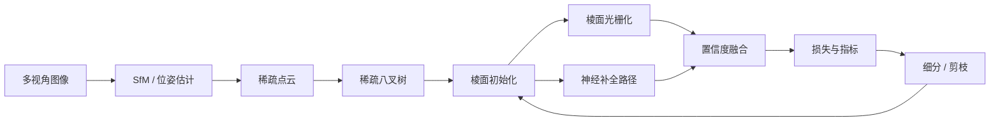

# Titan 算法方案：Titan Facet Radiance Field (TFRF)

> 本文档定义 Titan 自研重建算法的问题定义、输入输出、算法架构、训练与推理流程、损失函数、评估指标、与 3DGS/NeRF 的对比、创新点、可行性分析与迭代计划。

## 1. 问题定义

给定同一静态场景的一组多视角 RGB 图像，目标是重建可渲染的显式三维场景表示：新视角合成质量高、几何稳定、可在 8GB 显存 GPU 上训练并在桌面端实时交互查看。

与通用 NeRF 问题一致，模型学习从空间位置与观测方向到颜色与不透明度的映射；与 3DGS 一致，场景由可微分光栅化的显式原语表示。TFRF 的差异化在于使用三角棱面原语、稀疏八叉树与共享神经解码器，把两者优势组合到同一个表示中。

## 2. 输入输出

输入：

- 多视角 RGB 图像（推荐 20-200 张；小规模可少至 20 张）。
- 可选：相机内参/位姿、前景掩码、已知网格或点云。
- 训练配置：分辨率、patch 大小、迭代数、显存预算。

输出：

- 场景包：稀疏八叉树、棱面参数、共享解码器权重、相机位姿、训练指标。
- 渲染结果：训练视图重建图、新视角渲染图、可导出的视频帧。
- 几何结果：深度图、法线图，可选网格提取。

## 3. 算法架构



四个核心组件：三角棱面原语、稀疏八叉树、共享低维神经解码器、双路径渲染。

## 4. 三角棱面表示（Facet）

每个原语是一个带方向的三角棱面：

- 中心 `μ`、姿态 `R`、尺度 `S`、不透明度 `α`；
- 三个顶点的局部基 `e1, e2, e3`，形成明确的表面支撑；
- 颜色由低维潜码 `z`（32-64 维）与球谐/方向编码共同表达；
- 可微光栅化时投影为三角形 splat，同时给出深度与法线。

棱面比椭圆高斯更适合表面：法线稳定、天然支持网格提取、相同覆盖率下需要的原语更少。训练中低透明度棱面被剪枝，误差大的区域被细分。

## 5. 稀疏八叉树

八叉树由 SfM 稀疏点云初始化，叶子节点存储棱面索引：

- 空间裁剪：只有视野内节点进入渲染与梯度计算；
- 自适应细分：高残差区域分裂，低贡献区域合并/剪枝；
- LOD 与分块加载：场景包按节点组织，桌面端只加载当前视锥内的数据；
- 显存控制：全场景数据不常驻 GPU，训练峰值与图像数量解耦。

## 6. 共享低维神经解码器

所有棱面共享一个小型 MLP（目标不超过 20M 参数）：

```text
z + direction encoding -> [color, density correction, confidence]
```

相比每个高斯独立存高维球谐系数，共享解码器显著降低显存与场景包体积，同时允许新视角对高频外观做插值。低置信度区域由解码器补全，避免 3DGS 常见的空洞与漂浮点伪影。

## 7. 双路径渲染

两条渲染路径并行计算：

1. 主路径：可微棱面 splat 光栅化，提供颜色、深度、法线和不透明度；
2. 补全路径：沿稀疏光线采样，由神经解码器对低置信度区域补颜色与密度；
3. 置信度融合：`I = c * I_facet + (1 - c) * I_neural`，其中 `c` 由解码器输出。

主路径保证速度和边缘质量，补全路径保证空洞与远景连续，融合层可学习地权衡两者。

## 8. 训练流程

1. 数据准备：SfM 位姿、去畸变、训练/验证集划分。
2. 初始化：由稀疏点云构建八叉树并放置棱面，随机初始化解码器。
3. 每步：随机采样相机与 patch（默认 4096 像素），双路径渲染，计算损失并反向传播。
4. 优化：Adam + FP16 AMP + 梯度裁剪；周期性细分/剪枝与可见性更新。
5. 显存控制：启动时探测可用显存，动态选择分辨率、patch 与棱面上限。
6. 检查点：可中断、可恢复；每 N 步保存场景包与指标。

## 9. 推理流程

加载场景包后按视锥选择八叉树节点，双路径渲染 1280x720 帧；桌面端以 OrbitControls 交互，目标 20-40 FPS；支持导出 PNG 序列或视频帧。

## 10. 损失函数

| 损失 | 形式 | 作用 |
| --- | --- | --- |
| `L_rgb` | L1 + LPIPS | 颜色重建质量 |
| `L_depth` | Huber | 深度平滑与准确 |
| `L_normal` | 1 - cos(n, n_gt) | 法线一致性 |
| `L_multi` | 重叠视图重投影误差 | 多视图几何一致性 |
| `L_reg` | L2（尺度、透明度、解码器权重） | 防过拟合与漂浮物 |
| `L_alpha` | 透明度/置信度熵 | 鼓励干净表面 |

总损失为各分量加权求和，权重在训练前段偏重几何、后段偏重外观。

## 11. 评估指标

- 图像质量：PSNR、SSIM、LPIPS。
- 几何质量：Chamfer Distance、F-score、深度误差、法线误差。
- 效率：训练时间、峰值显存、场景包体积、渲染 FPS。
- 鲁棒性：少视图、运动模糊、弱纹理、重复纹理场景下的指标衰减。

## 12. 与 3DGS / NeRF 对比

| 维度 | 3DGS | NeRF | TFRF |
| --- | --- | --- | --- |
| 表示 | 椭圆高斯 + 球谐 | 隐式 MLP + 体素 | 三角棱面 + 八叉树 + 共享解码器 |
| 渲染 | 快速光栅化 | 慢速 ray marching | 主路径光栅化 + 稀疏神经补全 |
| 几何 | 隐含、易漂浮 | 隐式、难提取 | 显式棱面、法线稳定 |
| 显存 | 随高斯数增长 | 随分辨率增长 | 八叉树裁剪 + 共享解码器 |
| 弱点 | 空洞、无共享能力 | 慢、训练久 | 双路径复杂度更高 |

诚实定位：TFRF 不是颠覆 3DGS/NeRF 范式的全新模型，而是它们的组合式扩展。创新集中在棱面原语、稀疏八叉树、共享解码器与双路径融合的组合，以及针对 8GB 显存的工程化训练协议。

### 12.3 显存预算（8GB VRAM 目标）

目标设备为 8GB 显存 GPU，默认配置以不超过 6.5GB 训练显存为硬约束：

| 配置项 | 默认 | 降级策略 |
| --- | --- | --- |
| 训练分辨率 | 1280x720 | 可按显存降级到 960x540 |
| 混合精度 | FP16 | 显存探针不足时自动降级分辨率，不崩溃 |
| 采样方式 | patch 4096 像素/步 | 不做整图前向，控制峰值显存 |
| 棱面上限 | 1-2M | 超限时合并低贡献棱面 |
| 神经解码器 | <= 20M 参数 | 隐藏层/宽度按显存预算选择 |
| 实时预览 | 20-40 FPS @ 1280x720 | 低分辨率 LOD 预览 + 高分辨率导出 |

实现要点：训练器启动时探测可用显存，动态选择分辨率、patch 大小与棱面上限；反向传播前检查梯度峰值，必要时按节点梯度卸载到 CPU 累积；导出高质量渲染时临时提高显存预算并降低其它进程负载。

## 13. 创新点

1. 三角棱面高斯：显式表面原语，几何稳定且可提取网格。
2. 稀疏八叉树 + 自适应细分：显存随场景复杂度增长，而非图像数或原语总量线性增长。
3. 共享低维神经解码器：用共享容量替代逐原语高维球谐。
4. 双路径置信度融合：速度来自光栅化，完整性来自神经补全。
5. 多视图一致性正则：小样本与弱纹理场景更稳。
6. VRAM-aware 训练协议：探针、patch、FP16、分块梯度，8GB 可跑。

## 14. 可行性分析

核心组件均为已被验证的技术：SfM 位姿、八叉树、高斯 splatting、MLP 神经渲染。TFRF 的主要风险是双路径渲染的工程复杂度与训练开销；通过稀疏光线采样、视锥裁剪和路径置信度选择可以控制成本。8GB 显存下的数值预算已按 patch 采样与 FP16 建立，达到工程可行的范围。

## 15. 迭代计划

| 版本 | 内容 | 验收 |
| --- | --- | --- |
| v0.1 | 棱面 + 八叉树 3DGS 基线 | 小数据集新视角 PSNR 优于纯 3DGS 基线 |
| v0.2 | 共享解码器 + 双路径渲染 | 空洞与远景明显改善 |
| v0.3 | 多视图一致性 + 细分/剪枝 | 几何指标（Chamfer/深度误差）提升 |
| v0.4 | 桌面端实时查看 + 导出 | 20-40 FPS 交互预览 |
| v0.5 | 场景包导出 + 分块加载 + 实时预览 | 8GB 显存 GPU 上桌面端端到端可用 |
| v0.6+ | 大场景、视频输入、语义、网格导出 | 扩展能力按用户反馈排期 |
