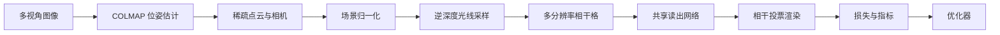

# Titan 算法方案：Titan Coherence Field (TCF)

> 本文档定义 Titan 自研隐式重建算法 TCF 的问题定义、输入输出、算法架构、训练与推理流程、损失函数、评估指标、创新点、可行性分析与迭代计划。

TCF 采用完全独立的场景表示与渲染协议：以多分辨率相干格作为场景记忆，以小共享读出网络完成外观解码，以光线相干投票完成新视角渲染。TCF 不参考任何既有重建方法，从表示、采样到渲染均为原创设计。

## 1. 问题定义

输入同一静态场景的一组多视角 RGB 图像，输出一个可渲染的隐式场景模型：给定任意新相机位姿，模型应生成与真实拍摄一致的彩色图像，同时满足训练显存可控（8GB VRAM 约束）、场景包体积小、渲染稳定无空洞等工程要求。

形式上，每条光线都对应一个三维坐标与观察方向的连续映射问题。TCF 不把场景拆成离散原语，而是让每个空间点携带一个“相干投票”：投票不仅描述该点的外观，还描述该点是否足以让光线在此落定。

## 2. 设计原则

TCF 的设计完全从零开始，遵循以下原则：

1. **完全隐式**：场景不保存任何显式原语、网格或离散点集，全部信息存放在连续可微的格子与网络中。
2. **单一共享容量**：所有空间位置共享同一套格子与读出网络，参数规模不随图片数或分辨率线性增长。
3. **投票式渲染**：渲染不依赖透明度累积，而由场景点对观察方向“投票”，投票权重由相干性与光线已携带量共同决定。
4. **显存优先**：训练、评估与导出均按光线批次和读出分块执行，峰值显存由批次大小控制，而不是由图片分辨率决定。
5. **可工程化**：支持取消、暂停、恢复、进度上报与显存降级，端到端流程可在一个任务中完成。

## 3. 输入输出

### 3.1 输入

- 多视角 RGB 图片（建议 20-200 张，最少 4 张）。
- 相机位姿与内参：由 COLMAP 估计，或读取已有位姿文件/缓存。
- 稀疏点云（可选）：仅用于近远面估计，不作为模型参数。
- 训练配置：步数、训练视图数、patch 大小、分辨率策略、格子规模、光线批次、采样数等。

### 3.2 输出

- 场景包：多分辨率相干格权重、共享读出网络权重、学习背景颜色、相机位姿、训练指标。
- 渲染结果：训练视图重建图、留出视图渲染图、新视角图。
- 评估指标：PSNR、SSIM、损失、峰值显存、格子体积。

## 4. 算法架构



### 4.1 多分辨率相干格（Coherent Lattice）

相干格是 TCF 的场景记忆，采用多分辨率哈希格子：

- 默认 8 层，基础分辨率 32，每层按 1.6 倍增长并封顶 512；
- 每层 131072 个条目，每个条目 4 维特征；
- 查询使用空间哈希与三线性插值，把连续 3D 坐标映射为每层上下文向量；
- 总参数约 16MB，参数规模与图片数量、分辨率无关。

低分辨率层负责整体结构与粗尺度外观，高分辨率层负责细节；各层通过插值平滑过渡，避免显式边界。

### 4.2 共享读出网络（Coherence Readout）

所有空间点共享同一个小型读出 MLP：

```text
格子上下文 + 位置编码 + 方向编码 -> [RGB 颜色, 相干分数, 携带门]
```

- 输入为 8 层格子特征、位置正弦编码与方向正弦编码；
- 隐藏层宽 64，共两层，输出 5 个通道；
- RGB 经 sigmoid 激活，相干分数为 logit，携带门经 sigmoid 激活；
- 参数不足 5MB，相邻空间与相近视角天然连续。

### 4.3 相干投票渲染

每条光线先做粗采样（默认 32 个逆深度点），再由期望深度做细采样（默认 16 个点）。对每个采样点：

1. 读出该点的颜色、相干分数与携带门；
2. 沿光线方向对携带门做前缀累计，形成“光线已携带量”carry；
3. 计算投票权重 `w = softmax(coherence - carry)`；
4. 最终颜色 `C = sum(w * rgb) + (1 - sum(w)) * bg`，其中 `bg` 为学习背景颜色。

这一机制让网络自行学习“光线应在哪个深度落定”：相干分数高的区域赢得投票，carry 则阻止光线把多次投票全部叠加，未覆盖区域由学习背景自然补全。

## 5. 场景归一化与采样

- 以相机位置中位数作为场景原点，以中位相机距离作为缩放基准，保证数值稳定；
- 由稀疏点云距离的 5%-95% 分位数估计近远面，并按逆深度均匀采样；
- 原分辨率训练时使用最大画布并受 `train_max_image_pixels`（默认 2M 像素）约束；不同长宽比图片保持纵横比居中贴边，相机内参同步缩放与平移。

## 6. 训练流程

1. 数据准备：COLMAP 位姿估计、图片加载、原分辨率画布归一化、训练/留出视图划分（用户滑动条调节训练视图数，其余为留出集）。
2. 初始化：随机初始化相干格与读出网络，背景使用小值常量。
3. 每步：随机选择一个训练相机与 patch 像素，构造光线；粗-细两级读出与投票渲染；计算颜色损失与背景正则并反向传播。
4. 优化：Adam + 余弦学习率 + AMP 混合精度 + 梯度裁剪。
5. 进度：每 10 步向前端上报一次步数、损失与显存；每 `eval_every` 步在留出视图上计算 PSNR/SSIM 并记录历史。
6. 控制：支持取消、暂停与恢复，通过 `control.json` 安全停止。

## 7. 推理流程

加载训练完成的模型后，按 `ray_batch=4096` 分块渲染任意尺寸图片，避免全分辨率单次前向。默认输出：

- 训练视图重建图；
- 留出视图渲染图及其指标；
- 围绕场景拟合的新视角轨道图。

结果写入 `scene.json` 与 `summary.json`，桌面端读取渲染图与相机轨迹进行展示。

## 8. 损失函数

| 损失 | 形式 | 作用 |
| --- | --- | --- |
| `L_rgb` | MSE（渲染颜色，目标颜色） | 颜色重建质量 |
| `L_bg` | `mean(relu(-bg)) * 0.02` | 约束背景颜色非负，稳定训练 |

总损失 = `L_rgb + L_bg`。当前版本保持最小损失集，后续迭代再逐步加入相干一致性与深度平滑正则，避免过早引入耦合。

## 9. 评估指标

- 图像质量：PSNR、SSIM、MSE；
- 资源效率：训练峰值显存、格子体积、每步耗时、端到端耗时；
- 稳定性：取消/暂停恢复后的可复现性、不同视图数量下的收敛曲线；
- 后续迭代：LPIPS 感知指标、深度一致性、新视角插值质量。

## 10. 显存预算（8GB VRAM）

目标设备为 8GB 显存 GPU，默认配置以不超过 6.5GB 训练显存为硬约束：

| 配置项 | 默认值 | 说明 |
| --- | --- | --- |
| 相干格 | 8 层 × 131072 条目 × 4 维 | 参数约 16MB |
| 读出网络 | 64 宽两层 MLP | 参数不足 5MB |
| 训练采样 | patch 1024-2048 像素/步 | 不做整图单次前向 |
| 光线批次 | 4096 条/批 | 显存峰值由批次控制 |
| 读出分块 | 131072 点/块 | 长光线列表分块前向 |
| 混合精度 | FP16 AMP | 默认开启 |
| 原分辨率 | 最大 2M 像素 | 训练与导出都按批次渲染 |

实测合成场景 160×160、120 步时峰值显存约 0.6GB，为真实高分辨率图片与系统 UI 预留充足余量。

## 11. 创新点

1. **多分辨率相干格**：哈希格是唯一的场景记忆，无显式原语，参数规模与图片数量解耦。
2. **光线相干投票**：以 `softmax(coherence - carry)` 作为渲染权重，网络自行学习光线停靠深度。
3. **共享小读出网络**：全局共享外观解码，参数少、空间连续、视角可插值。
4. **粗-细逆深度两级采样**：粗采样定位相干区域，细采样精化投票，计算量可控。
5. **原分辨率训练与分块渲染协议**：显存与分辨率解耦，8GB 显卡可处理真实图片。
6. **学习背景与可见性余量**：未覆盖区域自然过渡，减少空洞观感。

## 12. 可行性分析

- TCF 已在 RTX 4060 Ti 8GB（CUDA 11.8、PyTorch 2.7）上跑通 COLMAP → 训练 → 渲染完整链路，短流程端到端成功。
- 显存预算与批次挂钩，最坏情况下可进一步降低 patch 与 `ray_batch_size`，不会因单张高分辨率图片直接超限。
- 主要风险是复杂真实场景下哈希格子容量与投票收敛速度；通过格子层级自适应、更细采样与正则逐版本缓解。
- 主要风险是位姿误差与图片噪声；通过原分辨率训练、COLMAP 匹配参数与留出视图评估控制。

## 13. 迭代计划

| 版本 | 内容 | 验收 |
| --- | --- | --- |
| v0.2.0 | TCF 基线引擎 | 端到端流程、8GB 显存约束、取消/暂停/恢复、每 10 步进度 |
| v0.2.1 | 投票正则与更细采样 | PSNR/SSIM 提升、空洞减少 |
| v0.3 | 自适应格子分辨率与容量 | 复杂场景细节提升 |
| v0.4 | 深度/法线输出与场景交互 | 几何可视化与导出 |
| v0.5+ | 大场景分块、视频输入、语义 | 扩展能力 |
